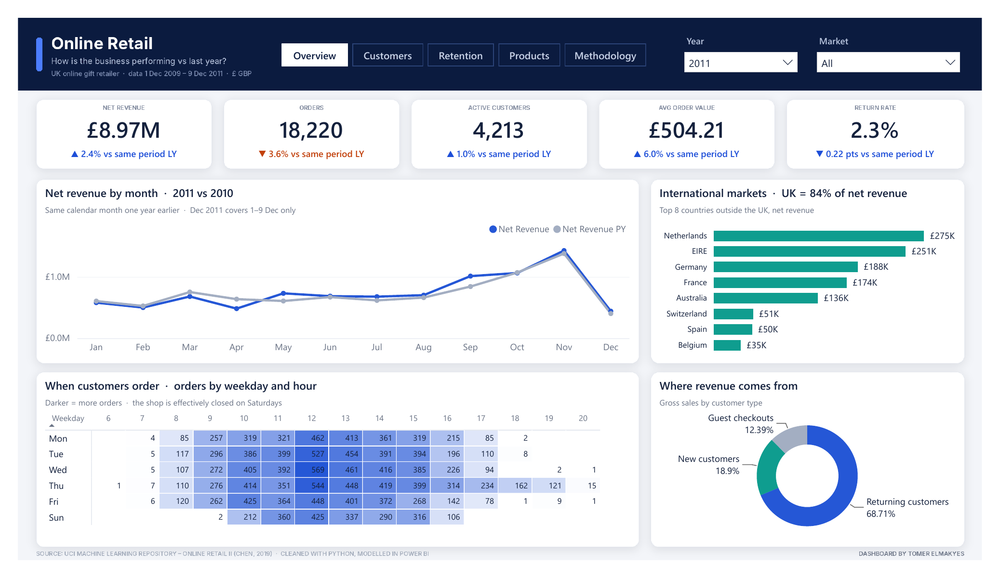
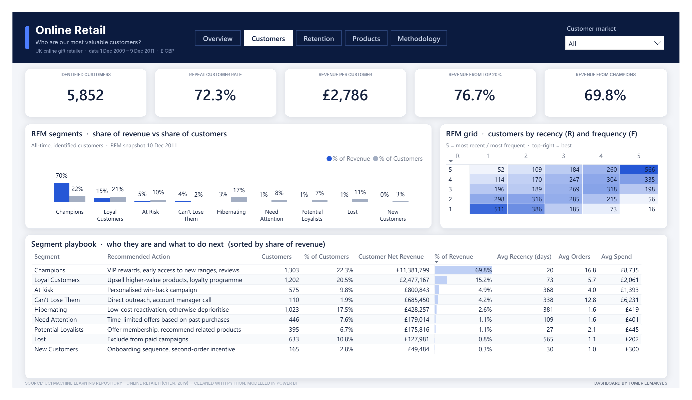
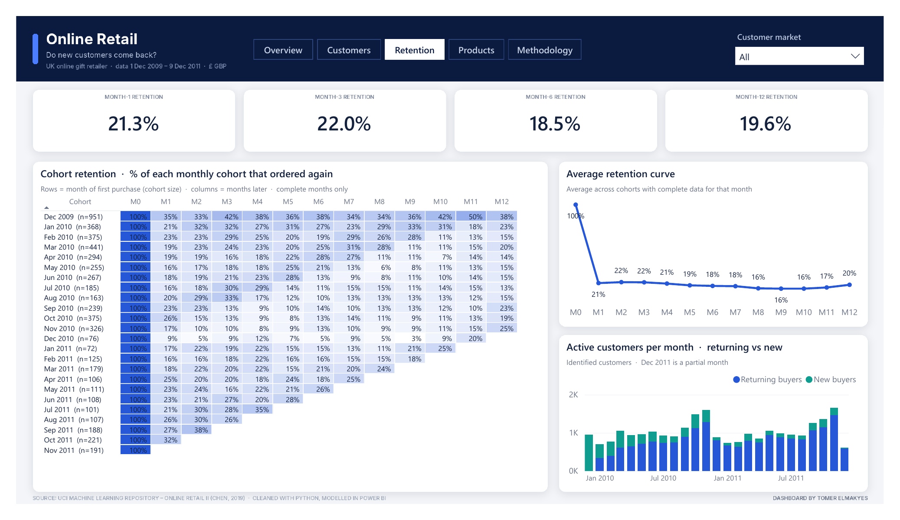
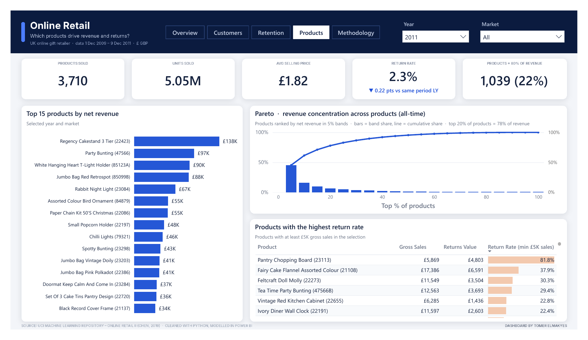
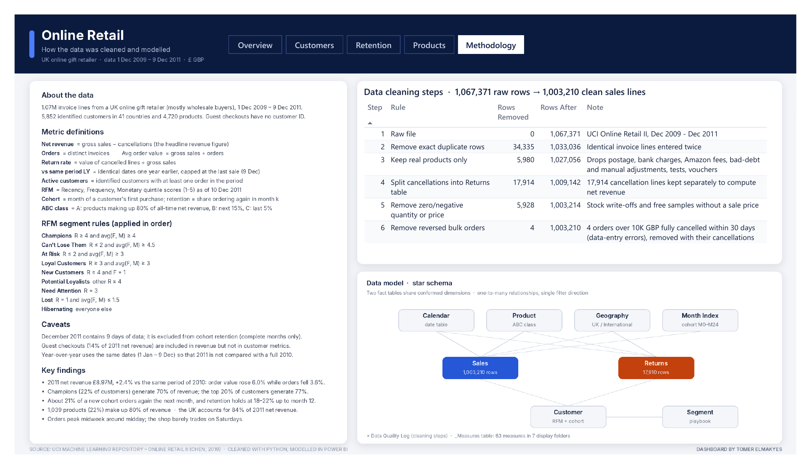

# Online Retail Analytics — Power BI

End-to-end analysis of a UK online gift retailer (UCI *Online Retail II*, Dec 2009 – Dec 2011, ~1.07M invoice lines).

**Stack:** Python (pandas) for cleaning and feature engineering → star-schema model in Power BI (PBIP / TMDL) → 5-page report.



## Pages
| Page | Question | Highlights |
|---|---|---|
| Overview | How is the business performing vs last year? | 5 KPIs with like-for-like YoY, monthly trend vs PY, international markets, weekday × hour heatmap, revenue by customer type |
| Customers | Who are our most valuable customers? | RFM segmentation (9 segments), R×F grid, segment playbook with recommended actions |
| Retention | Do new customers come back? | Monthly cohort triangle (M0–M12), average retention curve, returning vs new buyers |
| Products | Which products drive revenue and returns? | Top 15 products, Pareto / ABC analysis, highest return-rate products |
| Methodology | How was the data cleaned and modelled? | Cleaning log, metric definitions, RFM rules, caveats, key findings, star schema |

## Key findings
- 2011 net revenue £8.97M, +2.4% vs the same period of 2010: average order value rose 6.0% while orders fell 3.6%.
- Champions (22% of customers) generate 70% of revenue; the top 20% of customers generate 77%.
- About 21% of a new cohort orders again the next month; retention holds at 18–22% up to month 12.
- 1,039 products (22%) make up 80% of revenue; the UK accounts for 84% of 2011 net revenue.

## Data cleaning (ETL/etl.py)
1,067,371 raw rows → 1,003,210 clean sales lines: duplicates removed, non-product codes (postage, fees, adjustments) dropped, cancellations split into a Returns table, zero/negative quantity or price removed, and 4 reversed bulk orders (≥ £10K, fully cancelled within 30 days) excluded.

## Model
Fact tables `Sales` and `Returns`; dimensions `Calendar`, `Customer`, `Product`, `Geography`, `Segment`, `Month Index`; 63 DAX measures in 7 display folders.

## Screenshots
| Customers | Retention |
|---|---|
|  |  |
| **Products** | **Methodology** |
|  |  |

A PDF export of all pages is in `Screenshots/Online_Retail_Analytics.pdf`.

## Repository structure
```
Online_Retail_Analytics.pbix            Power BI file (data included)
Online_Retail_Analytics.pbip            Power BI project (text format)
Online_Retail_Analytics.Report/         report definition, theme and page backgrounds
Online_Retail_Analytics.SemanticModel/  TMDL model: tables, relationships, DAX measures
ETL/etl.py                              cleaning and feature-engineering script
Screenshots/                            page images and PDF export
```

## How to open
- **Quickest:** open `Online_Retail_Analytics.pbix` in Power BI Desktop. The data is already inside.
- **Project version:** the clean CSV files are not stored in this repo. Download *Online Retail II* from the UCI repository, load both sheets into one pandas DataFrame saved as a pickle, and run `python ETL/etl.py raw.pkl Data` to create the `Data\` folder. Then open `Online_Retail_Analytics.pbip`, go to *Transform data → Edit parameters*, set `DataFolder` to the full path of that `Data\` folder (ending with `\`), and click *Refresh*.

Source: Chen, D. (2019). *Online Retail II*. UCI Machine Learning Repository.
